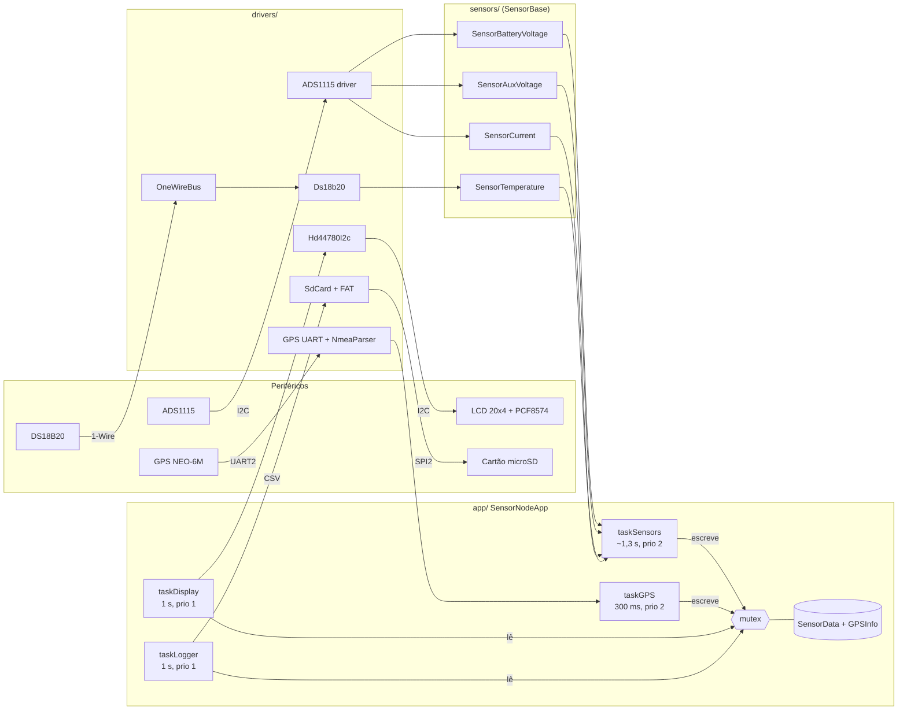

# Telemetria embarcada para barco solar (ESP32 + FreeRTOS)

[](../../actions/workflows/ci.yml)

Firmware em C++ (ESP-IDF) que lê tensão das baterias, corrente, temperatura e posição/velocidade GPS de um barco solar, mostra tudo em tempo real num LCD 20x4 e grava um log CSV em cartão SD. Nasceu como projeto final da disciplina **Programação C++ para Sistemas Embarcados** e é usado pela equipe de competição de barcos solares **VS Bigode**, que autorizou a publicação. Os drivers dos periféricos foram escritos do zero sobre a HAL do ESP-IDF, sem bibliotecas de terceiros.

## Destaques técnicos

- **FreeRTOS com 4 tasks** (sensores a cada ~1,3 s, dos quais 750 ms são a conversão do DS18B20; GPS 300 ms; display 1 s; log 1 s) compartilhando dados por um mutex.
- **Drivers próprios**: ADS1115 (I2C, API `i2c_master`), LCD HD44780 via expansor PCF8574 (I2C), GPS NEO-6M (UART2) e DS18B20 sobre 1-Wire em bit-bang.
- **Log CSV em cartão SD** (SPI + FAT): um arquivo novo `LOGnnnn.CSV` a cada boot, `fsync` a cada 10 linhas e remontagem automática se o cartão for removido e reinserido. A formatação do CSV é pura e testada no host.
- **Parser NMEA puro** (`NmeaParser`, sem dependência de hardware) para sentenças RMC/GGA de qualquer talker (`$GP`, `$GN`...), com validação de checksum obrigatória.
- **DS18B20 com verificação CRC-8** do scratchpad.
- **Hierarquia de sensores**: cada grandeza é uma classe derivada da abstrata `SensorBase`.
- **Filtro de média móvel** em template `Average<T, N>` com buffer circular (sem alocação dinâmica).
- **Testes em host** (CMake/CTest) para a lógica pura e **CI** no GitHub Actions compilando o firmware com ESP-IDF v5.5.1.

## Hardware

| Componente | Função | Interface | Pinos ESP32 |
|---|---|---|---|
| ESP32 DevKit V1 | MCU (dual-core, FreeRTOS) | – | – |
| ADS1115 (end. `0x48`) | ADC 16 bits: tensões e corrente | I2C | SDA GPIO21, SCL GPIO22 |
| LCD 20x4 HD44780 + PCF8574 (end. `0x27`) | Exibição local | I2C (mesmo barramento) | SDA GPIO21, SCL GPIO22 |
| GPS NEO-6M V2 | Posição, velocidade, satélites | UART2, 9600 baud | RX GPIO16 (← TX do GPS), TX GPIO17 |
| DS18B20 | Temperatura | 1-Wire (bit-bang) | DATA GPIO4 |
| Módulo microSD (alimentado em 3V3) | Log CSV | SPI2 (`SPI2_HOST`) | CS GPIO5, MOSI GPIO23, MISO GPIO19, SCK GPIO18 |
| Divisor resistivo (10k + 1k, fator 11) | Tensão da bateria | ADS1115 CH0 | – |
| Divisor resistivo (10k + 1k, fator 11) | Tensão auxiliar | ADS1115 CH1 | – |
| Sensor de corrente de efeito Hall | Corrente do sistema (offset 2,5 V) | ADS1115 CH3 | – |
| 2x LM2596 (3,3 V e 5 V) + conversor de nível 3V3/5V | Alimentação e interface com o LCD 5 V | – | – |

## Arquitetura

Estado atual do firmware (MQTT ainda não faz parte dele):



`taskSensors` e `taskGPS` produzem dados e os gravam na estrutura compartilhada; `taskDisplay` copia um snapshot sob o mutex e só então escreve no LCD, alternando duas páginas (velocidade/satélites/tensão/corrente e tensão auxiliar/temperatura/latitude/longitude). `taskLogger` faz o mesmo e grava uma linha CSV no cartão SD por segundo; o mutex nunca fica preso durante o acesso ao cartão.

### Formato do log

A cada boot o firmware lista `/sdcard`, encontra o maior `LOGnnnn.CSV` existente e cria o seguinte (nomes 8.3, pois o FATFS do ESP-IDF vem sem nomes longos por padrão). Cabeçalho:

```text
uptime_ms,vbat_v,vaux_v,current_a,temp_c,lat,lng,speed_kmh,sats
```

Exemplo de formato (valores ilustrativos, não é uma medição):

```text
12345,12.600,5.050,3.200,25.50,-23.550520,-46.633308,12.3,7
```

Tensões e corrente com 3 casas, temperatura com 2, latitude/longitude com 6 e velocidade com 1. Valor inválido (NAN) é gravado como campo vazio. `uptime_ms` é o tempo desde o boot (não há RTC). Sem fix do GPS, latitude, longitude e velocidade ficam vazias (o parser guardaria a última posição) e `sats` continua indicando a qualidade do sinal.

Robustez:

- **`fflush` + `fsync` a cada 10 linhas** (~10 s): num corte de energia perdem-se no máximo os últimos ~10 s; sincronizar a cada linha gastaria mais o flash do cartão (cada `fsync` regrava setor de dados e FAT) e aumentaria a latência da task.
- **Cartão removido ou erro de escrita**: o arquivo é fechado, o cartão desmontado e a cada 5 s o firmware tenta remontar e abrir um arquivo novo. Sem cartão no boot, o sistema funciona normalmente sem log e entra no mesmo ciclo de tentativas. A remoção do cartão só é percebida na próxima escrita ou sincronização (até ~10 s).
- O cartão nunca é formatado automaticamente (`format_if_mount_failed = false`).

O driver SD (pinos, `SPI2_HOST`, montagem FAT) foi validado em bancada num teste isolado; **o log integrado a este firmware ainda precisa de validação em bancada** (remoção/reinserção do cartão, corte de energia).

### Camadas

| Pasta | Responsabilidade |
|---|---|
| `drivers/` | Acesso direto ao hardware: ADS1115, LCD HD44780 via PCF8574, GPS (UART) e o parser NMEA, barramento 1-Wire e DS18B20, cartão SD (SPI + FAT). |
| `sensors/` | Conversão de leituras brutas em grandezas físicas (fator do divisor, offset do sensor Hall, °C), cada uma derivada de `SensorBase` e filtrada por média móvel. |
| `app/` | `SensorNodeApp`: inicializa barramentos e periféricos, cria as tasks e mantém os dados compartilhados (`TelemetryData.h`). |
| `utils/` | Componentes genéricos sem dependência de hardware, como `Average<T, N>` e a formatação do CSV (`CsvLog`). |

## Estrutura do repositório

```text
.
├── firmware/                 Projeto ESP-IDF
│   ├── CMakeLists.txt
│   ├── main/
│   │   ├── main.cpp          app_main(): cria e inicia SensorNodeApp
│   │   ├── app/
│   │   ├── drivers/
│   │   ├── sensors/
│   │   └── utils/
│   └── test/host/            Testes em PC (CMake + CTest)
├── .github/workflows/ci.yml  Build do firmware + testes em host
├── LICENSE
└── README.md
```

## Como compilar e gravar

Requer **ESP-IDF v5.5.x** instalado e exportado (`export.sh` / `export.ps1`).

```bash
cd firmware
idf.py set-target esp32
idf.py build flash monitor
```

Para indicar a porta serial: `idf.py -p COM5 flash monitor` (Windows) ou `-p /dev/ttyUSB0` (Linux).

## Testes em host

A lógica sem dependência de hardware (parser NMEA, média móvel, CRC-8, formatação do CSV e nomes dos arquivos de log) é compilada e testada no PC, sem ESP32:

```bash
cmake -S firmware/test/host -B build-host
cmake --build build-host
ctest --test-dir build-host -C Debug --output-on-failure
```

O `-C Debug` é necessário com geradores multi-config (Visual Studio); em Linux/macOS é ignorado.

## Validação em bancada

Os casos abaixo foram executados no hardware real e constam do relatório parcial da disciplina. **Referem-se à versão anterior à refatoração atual** (driver I2C legado, sem CRC no DS18B20). O relatório registra apenas aprovado/reprovado: **não há medições numéricas** (erro percentual, tempo de operação contínua etc.).

| Caso de teste | Resultado esperado | Status |
|---|---|---|
| LCD inicializa e exibe mensagem | Texto inicial na tela | Passou |
| Leitura GPS: lock e parsing NMEA | Lat/Lng/satélites atualizando | Passou |
| Leitura ADS1115 CH0 | Tensão correta após o fator do divisor | Passou |
| Leitura ADS1115 CH1 | Tensão auxiliar correta | Passou |
| Leitura ADS1115 CH3 | Corrente estável | Passou |
| Leitura de temperatura DS18B20 | Temperatura válida | Passou |
| Atualização simultânea em tasks | LCD atualiza corretamente | Passou |
| Concorrência com mutex | Sem travamentos | Passou |

Limitações apontadas no mesmo relatório: 1-Wire sem CRC (tratado na refatoração), atualização do LCD baseada em delays fixos e um único mutex para todos os dados, que pode gerar contenção com carga maior. O plano de testes previa critérios quantitativos (leituras dentro de ±5% do valor real, 30 min de operação contínua sem travamento) que ainda não foram medidos e documentados.

## Roadmap

- [ ] Envio via MQTT sobre Wi-Fi (TLS) e painel web
- [ ] Enlace LoRa barco–terra (já existe um driver SX1276 por registradores, ainda fora deste repositório)
- [ ] Barramento CAN
- [ ] Atualização OTA
- [ ] Watchdog para recuperação em caso de travamento
- [ ] Calibração fina dos fatores dos sensores analógicos

## Licença

[MIT](LICENSE) © 2026 Caio Ruppert
